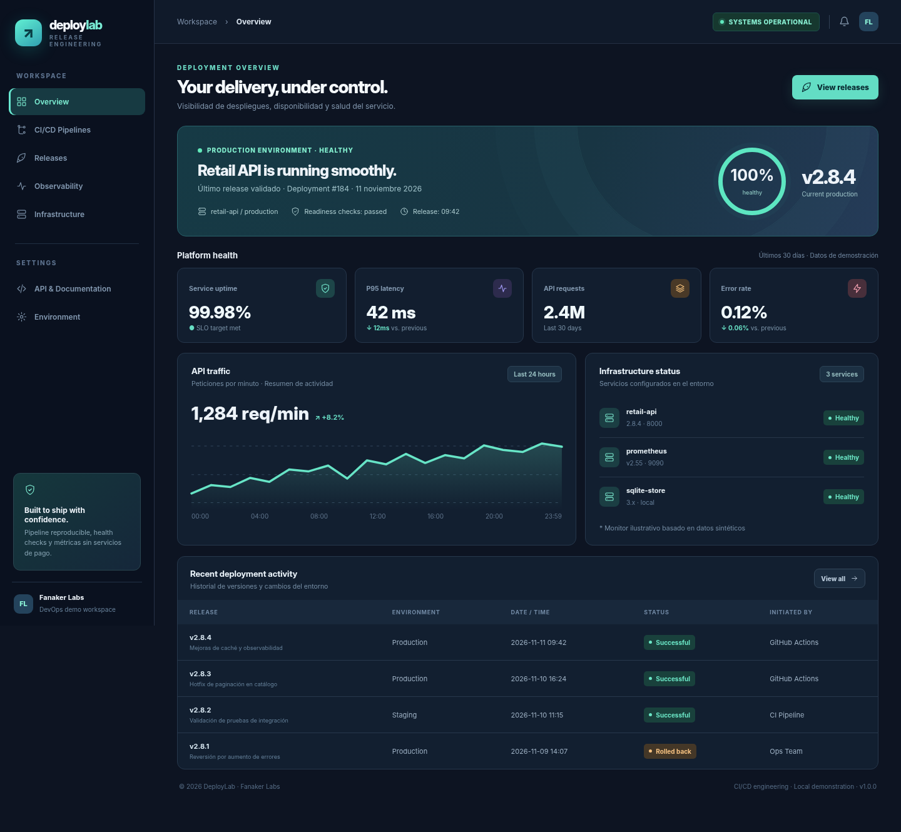
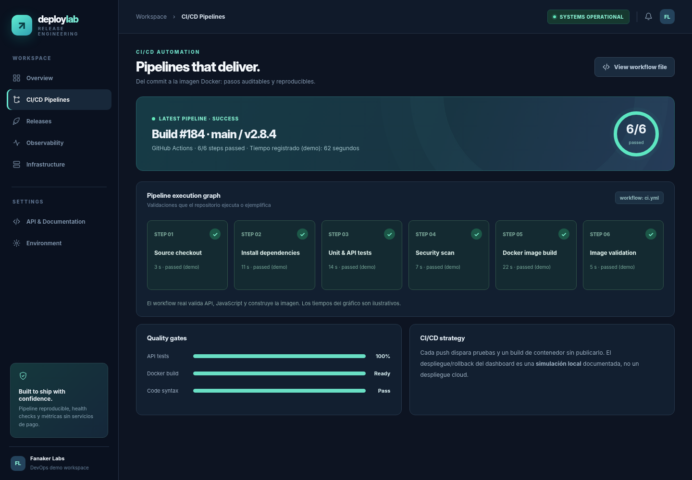
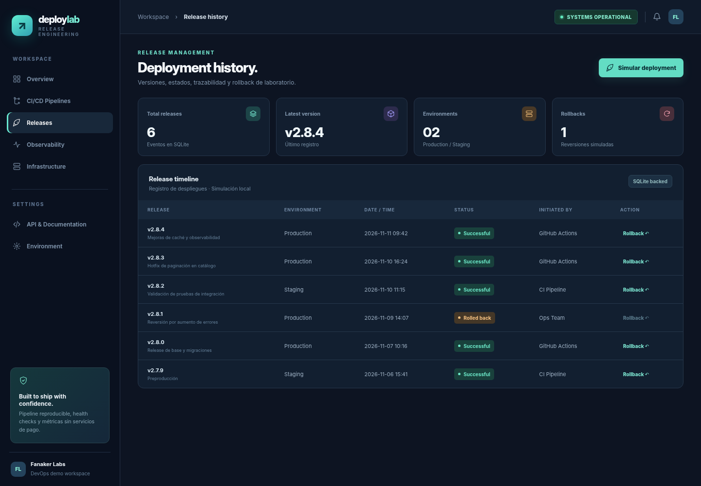
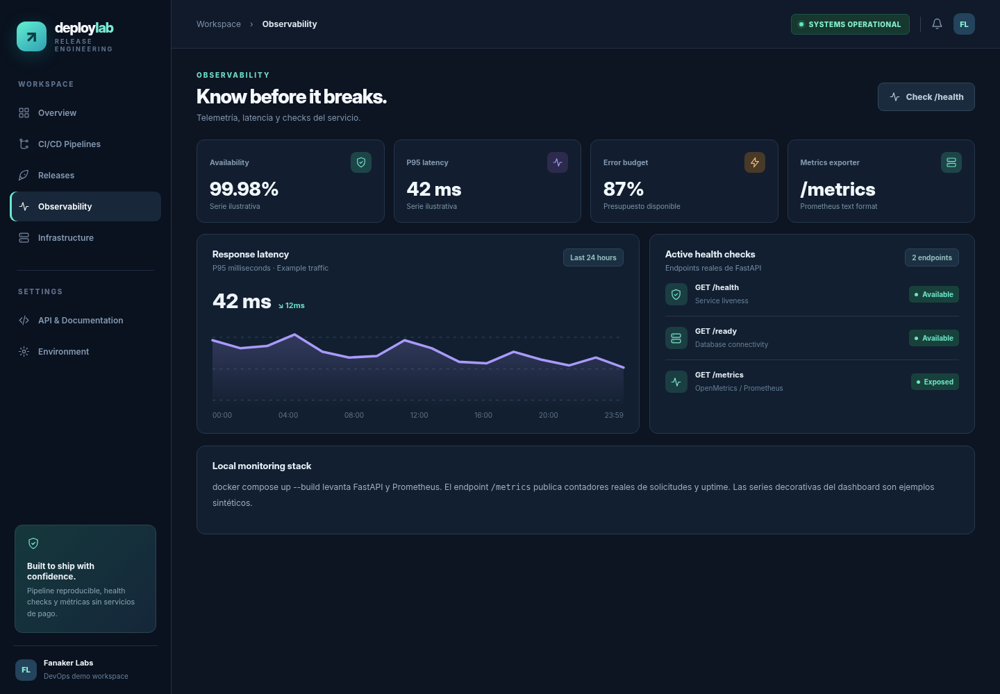
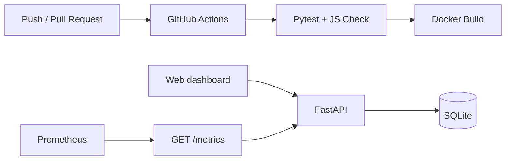

# DeployLab · Release Engineering Console

**DevOps · CI/CD · Observability**

Laboratorio de entrega continua con una pequeña aplicación FastAPI, un dashboard de operaciones, **Docker**, **GitHub Actions** y **Prometheus**. Permite estudiar el ciclo de build/test, health checks, métricas y un historial de releases con simulación local de rollback, sin publicar infraestructura.

**Tecnologías:** Python · FastAPI · Docker · Docker Compose · GitHub Actions · Prometheus · SQLite · REST · HTML/CSS/JS



## Qué demuestra

- **Entrega reproducible:** un `Dockerfile` con usuario no privilegiado y healthcheck.
- **CI:** workflow GitHub Actions que ejecuta pruebas y construye una imagen Docker, sin publicarla.
- **Observabilidad real:** `/health`, `/ready` y `/metrics` en formato Prometheus.
- **Orquestación local:** Docker Compose para la API y Prometheus con scrape cada 15 segundos.
- **Gestión de releases (demo):** versiones, entorno, estado e historial persistente en SQLite.
- **Simulación de despliegue y rollback:** registra operaciones y estados de ejemplo, **no realiza despliegues de producción**.

## Capturas

| Pipeline CI/CD | Historial de releases |
|---|---|
|  |  |



**Transparencia de las métricas:** el tráfico, uptime histórico, latencias, servicios ficticios y tiempos de pasos del panel están precargados como **datos sintéticos ilustrativos**. Los endpoints `/health`, `/ready` y `/metrics` son ejecutables; `/metrics` contiene contadores reales de peticiones al proceso. Las capturas muestran el frontend incluido, renderizado con la API de demostración.

## Inicio rápido (Python)

```bash
python -m venv .venv
# Windows (PowerShell): .\.venv\Scripts\Activate.ps1
# macOS/Linux: source .venv/bin/activate
pip install -r requirements.txt
uvicorn app.main:app --reload
```

Dashboard: **http://127.0.0.1:8000** · OpenAPI: **http://127.0.0.1:8000/docs**.

## Docker y Prometheus

Con Docker Engine / Docker Desktop instalado:

```bash
docker compose up --build
```

- App y dashboard: `http://localhost:8000`
- Métricas sin procesar: `http://localhost:8000/metrics`
- Prometheus: `http://localhost:9090`

Para detener: `docker compose down` (los datos quedan en un volumen; para borrarlos utilizar `docker compose down -v`).

Docker es **opcional** para ejecutar la app con Python. La construcción de contenedores no fue verificada en el entorno usado para preparar este repositorio; el Dockerfile y Compose quedan preparados para ejecutarse en un equipo con Docker.

## Tests

```bash
python -m pytest -q
node --check web/app.js
```

El pipeline `.github/workflows/ci.yml` ejecuta las pruebas y el build de contenedor en cada push y pull request. No publica imágenes ni requiere secretos. La etapa visual de *security scan* y el diagrama de seis pasos del dashboard son **ilustrativos**; el workflow versionado actualmente prueba API, JavaScript y build Docker.

## API principal

| Método | Endpoint | Descripción |
|---|---|---|
| GET | `/health` | Liveness del servicio |
| GET | `/ready` | Verifica conexión SQLite |
| GET | `/metrics` | Métricas Prometheus |
| GET | `/api/overview` | Panel y releases demo |
| POST | `/api/simulate/deploy` | Registra release simulado |
| POST | `/api/simulate/rollback/{id}` | Marca release como revertido |

Ejemplo de payload: `{"version":"v2.8.5","environment":"staging","notes":"Ensayo local"}`.

## Arquitectura



```text
DeployLab/
├── app/                       # FastAPI, simulación, metrics
├── web/                       # Dashboard dark-mode
├── tests/                     # Pruebas funcionales
├── infra/prometheus/          # Scrape config
├── docs/screenshots/          # Capturas
├── .github/workflows/ci.yml   # CI/CD
├── Dockerfile
└── docker-compose.yml
```

Proyecto complementario a QualityLab pero **independiente**, instalable y evaluable sin los otros repositorios.

---

## Autor y licencia

**Fanaker Labs** · Proyecto personal de entrega continua, gestión de releases y observabilidad. Código bajo licencia [MIT](LICENSE).
